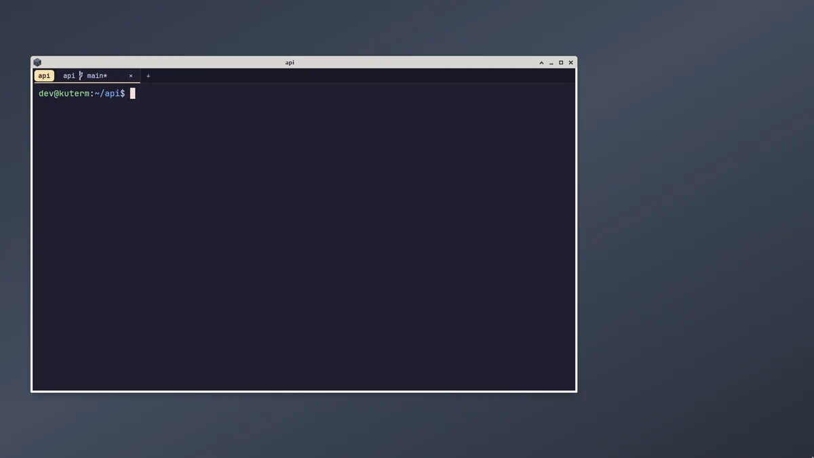

[](https://github.com/roworu/kuterm/actions/workflows/test.yml)
[](https://github.com/roworu/kuterm/actions/workflows/release.yml)
[](https://scorecard.dev/viewer/?uri=github.com/roworu/kuterm)

highly configurable, gpu accelerated terminal

<br clear="right">

## showcase

tabs grouped by project, splits with live cpu, memory and port metrics, completions, and themes
previewed in the command palette:



ready presets with videos, from minimal to everything turned on: [examples/presets](examples/presets)

## installation

download binaries for linux, macos or windows from [releases](https://github.com/roworu/kuterm/releases).

or build from source:

```bash
cargo build --release
```

## settings

config lives in `~/.config/kuterm/` (or whatever is your `$XDG_CONFIG_HOME`) and is created with defaults on first launch:

- `settings.jsonc`: fonts, tabs, titles, shell, cursor, themes (color schemes by name, picked for dark and light mode), keybindings (`null` disables a key), command palette (ctrl-shift-p) commands and tab icons

changes apply as soon as a file is saved. a broken file keeps the last good config and shows the error in the window. `"import"` merges other files first, so the config can be split by hand, and an `"os"` block sets values for one system only.

each option described in file with comments, you don't need any external docs to set it up.

partial changes work, missing values use defaults. you can just override things you need and remove others, to accept defaults.

you can check default settings used by terminal inside that repo: [Settings](https://github.com/roworu/kuterm/tree/main/assets)

## development

needed build tasks for `zed` and `vscode` are in according folders:

- `podman: build + test`: build and test dev version inside a podman (to not rely on system packages)
- `run app`: run that dev build from `./target/podman/debug/kuterm`
- `podman: e2e tests`: run the real app on a virtual display and check it by pixels, writes a report with screenshots of every tested feature to `e2e/artifacts/report.html`
