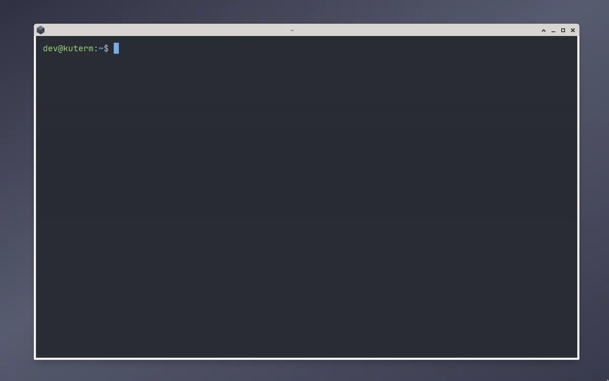
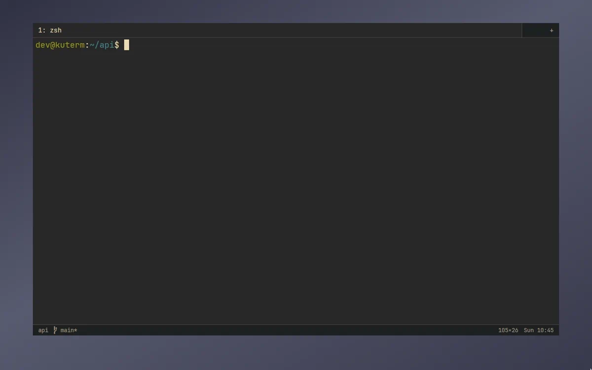
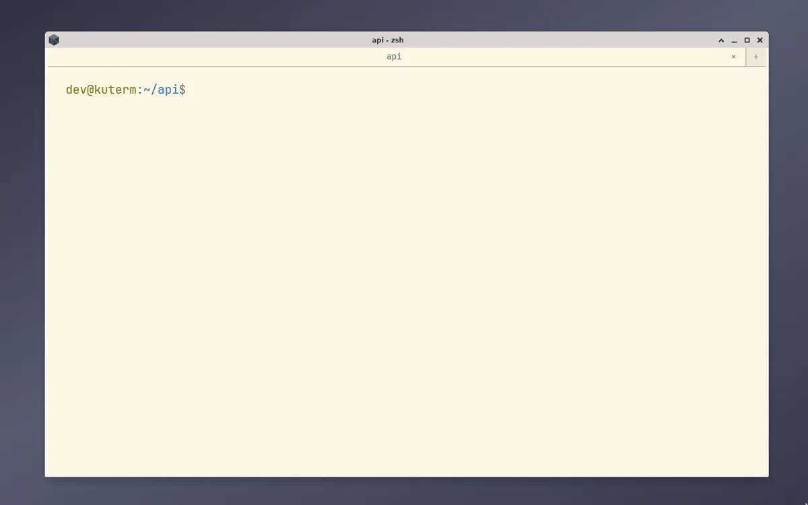
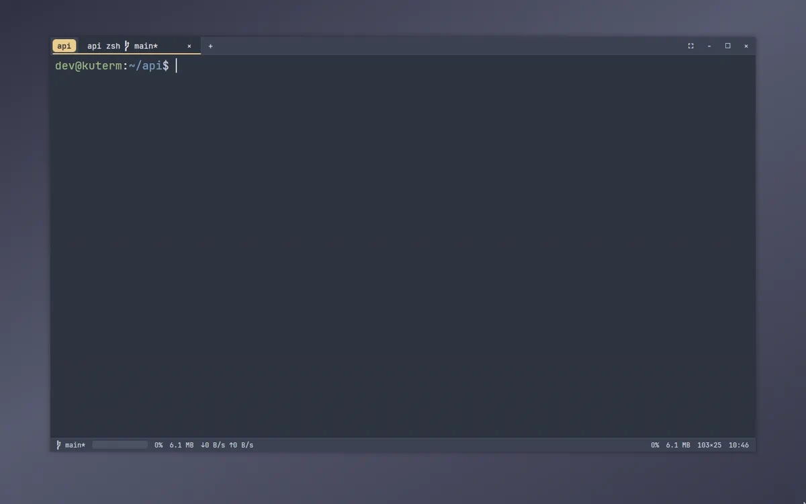
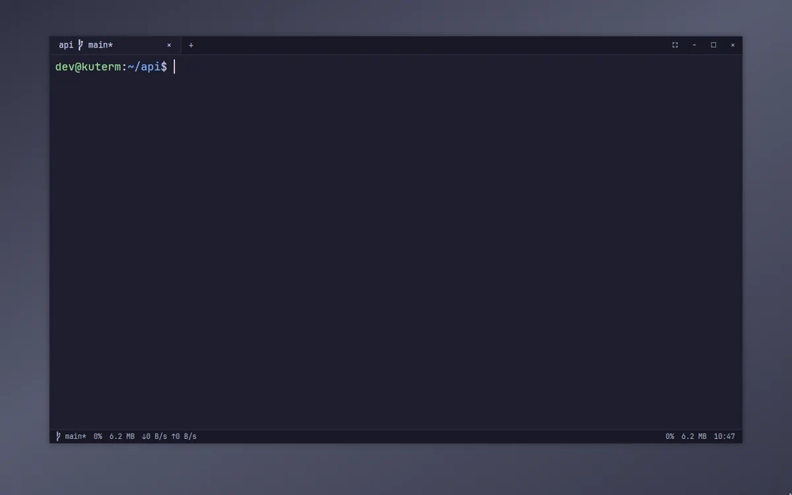
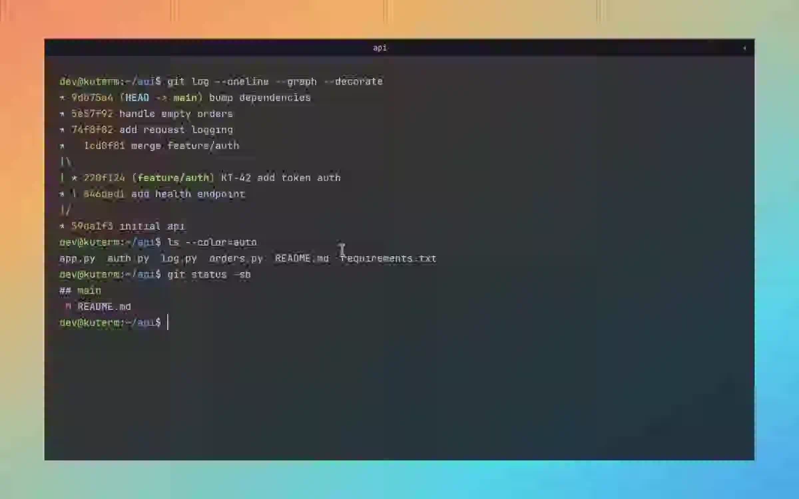
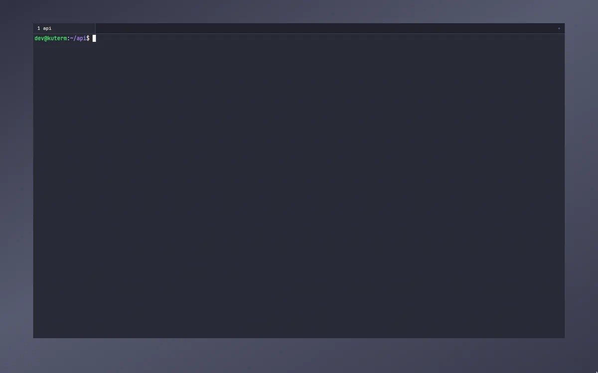
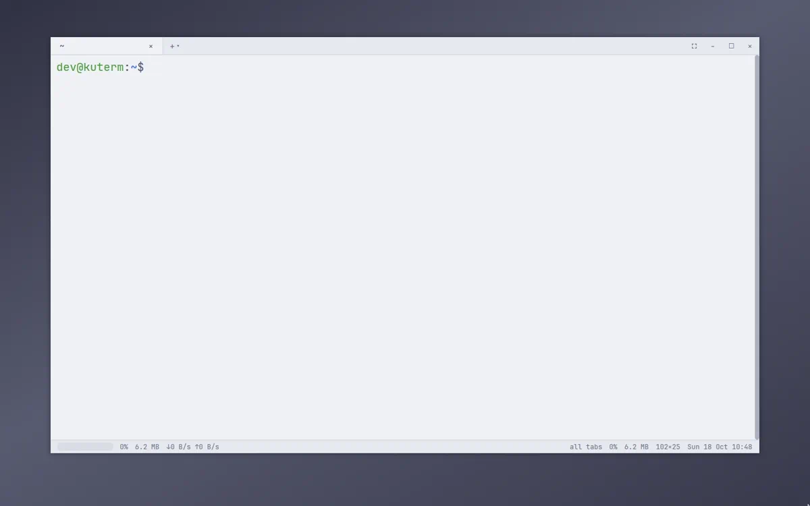

# presets

ready settings files, each with a demo of it in use. copy one to `~/.config/kuterm/settings.jsonc`, or keep your own file and pull one in with `"import": ["path/to/preset/settings.jsonc"]`. a preset only lists what it changes, everything else keeps its default from `assets/default_settings.jsonc`.

## minimal

just the shell in the bundled one dark colors: no tab bar while one tab is open, no scrollbar, no popups, icons or bell flashes, the desktop draws the frame.

[settings](minimal/settings.jsonc)



## tmux

splits and tabs on a `ctrl-a` prefix: `v` / `s` split, `h j k l` move between panes, `z` zooms, `c` opens a tab, `n` / `p` switch tabs. panes without focus are dimmed, gruvbox colors, a status bar with folder, git and time.

[settings](tmux/settings.jsonc)



## reading

a calm light terminal for docs and logs: solarized light, big text with tall lines, wide margins, higher minimum contrast, stretched tabs with centered titles, and smooth scrolling through a long request log.

[settings](reading/settings.jsonc)



## dev

a development workspace in nord colors: tabs grouped by git project, titles with progress, command, branch and ports, a full status bar, completions, editor links and dimmed splits. `ctrl-shift-r` / `d` split, `ctrl-alt-h j k l` move between panes.

[settings](dev/settings.jsonc)



## agents

for ai coding agents in catppuccin mocha colors: the tab of an agent that stopped to wait for you gets a mark, and the window tells you when that tab is not in front. `ctrl-shift-j` jumps to the agent that waited longest, `ctrl-shift-g` lists them all. titles show progress, git and queued commands, the status bar shows cpu, memory and ports.

[settings](agents/settings.jsonc)



## glass

a borderless, see-through window in tokyo night colors: the desktop behind shows through the terminal, text stays solid, wide padding and tall lines keep it airy. the transparency needs a compositor.

[settings](glass/settings.jsonc)



## compact

for small screens and tiling window managers in dracula colors: small ui and text, thin padding, narrow numbered tabs, no status bar and a slim scrollbar. splits are on `ctrl-shift-r` / `d`, `ctrl-alt-h j k l` moves between panes.

[settings](compact/settings.jsonc)



## showcase

most features at once in light catppuccin latte colors: tabs grouped by git project with branch and ports in their titles, tabs dragged onto each other to group them like in chrome, a full status bar (git, cpu graph, memory, network, ports, clock), the completion popup, dimmed splits, profiles for a server and podman and docker containers, and extra palette commands and keys.

[settings](showcase/settings.jsonc)



## demos

recorded as animated webp at 60 fps, scaled to 1200 px wide, by `tools/presets/record.sh`: kuterm runs with the preset on a virtual display with a window manager inside podman, typed into and clicked like a person would, and filmed with ffmpeg. the readme showcase is recorded by the same script as `readme`. the glass demo is recorded on a live KDE Wayland session instead, because x11 recording cannot show the window opacity. to record a preset again, or a few of them:

```bash
sh tools/presets/record.sh
sh tools/presets/record.sh showcase
sh tools/presets/record.sh readme
```
