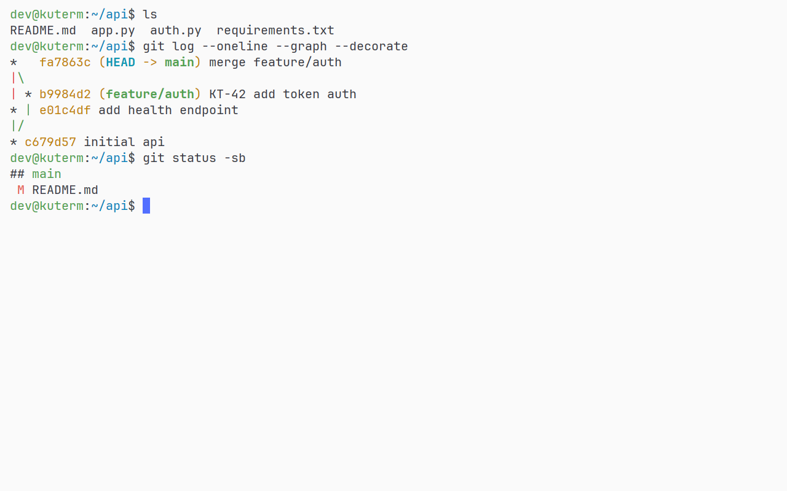
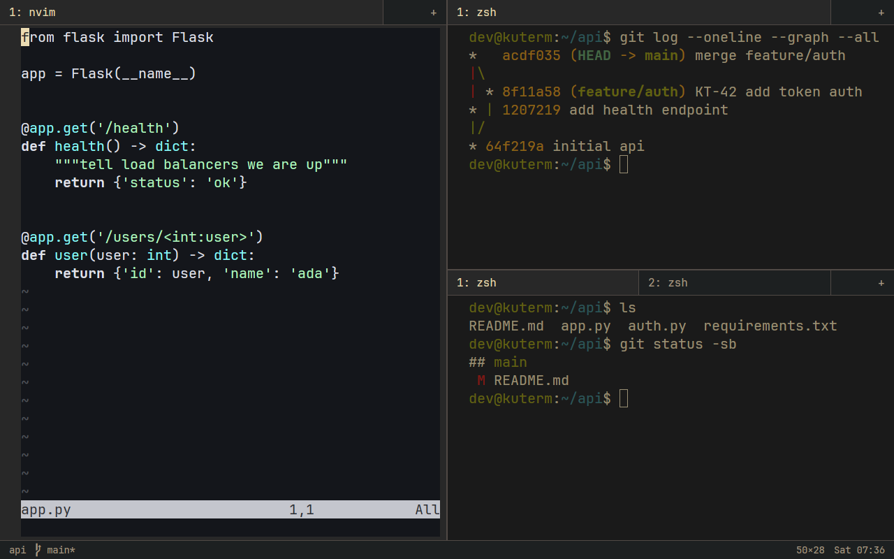
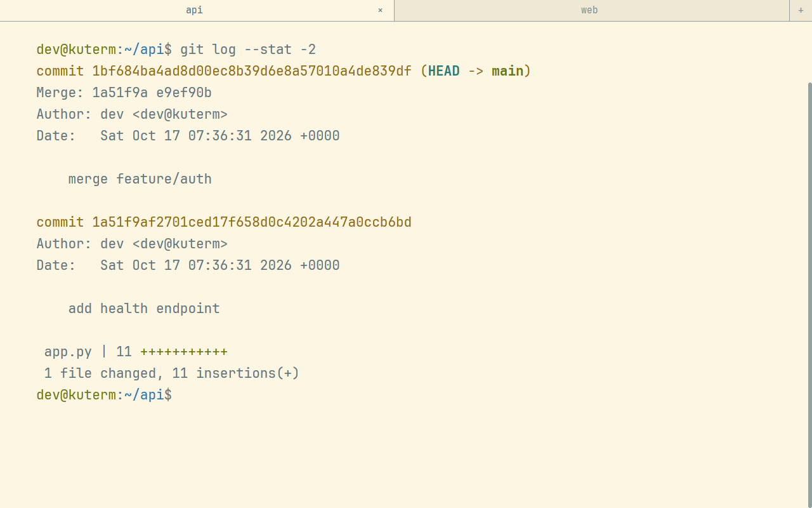
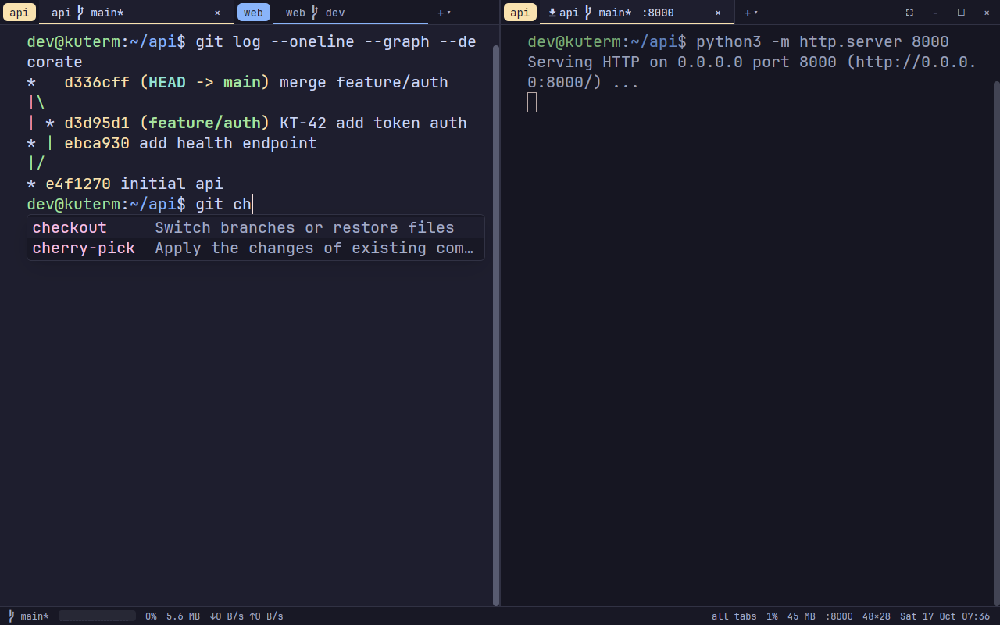

# presets

ready settings files, each with a screenshot. copy one to `~/.config/kuterm/settings.jsonc`, or keep your own file and pull one in with `"import": ["path/to/preset/settings.jsonc"]`. a preset only lists what it changes, everything else keeps its default from `assets/default_settings.jsonc`.

## minimal

just the shell: no tab bar while one tab is open, no scrollbar, no popups, marks, icons or bell flashes, the desktop draws the frame.

[settings](minimal/settings.jsonc)



## tmux

splits and tabs on a `ctrl-a` prefix: `v` / `s` split, `h j k l` move between panes, `z` zooms, `c` opens a tab, `n` / `p` switch tabs. panes without focus are dimmed, gruvbox colors, a status bar with folder, git and time.

[settings](tmux/settings.jsonc)



## reading

a calm light terminal for docs and logs: solarized light, big text with tall lines, wide margins, higher minimum contrast, stretched tabs with centered titles.

[settings](reading/settings.jsonc)



## showcase

most features at once: tabs grouped by git project with branch and ports in their titles, a full status bar (git, cpu graph, memory, network, ports, clock), the completion popup, dimmed splits, marks next to commands, profiles for a server, a sandbox and incognito, and extra palette commands and keys.

[settings](showcase/settings.jsonc)



## screenshots

taken by `e2e/test_presets.py`, which also checks every preset loads without a complaint. to refresh them:

```bash
sh e2e/run.sh -k presets
for p in minimal tmux reading showcase; do cp e2e/artifacts/presets-x11/$p.png examples/presets/$p/screenshot.png; done
```
